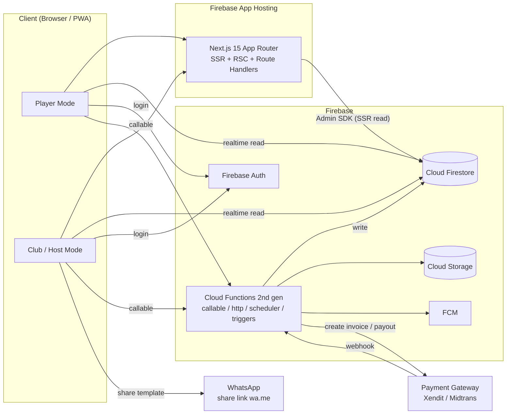
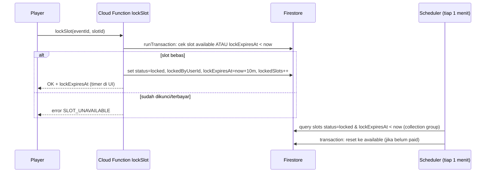
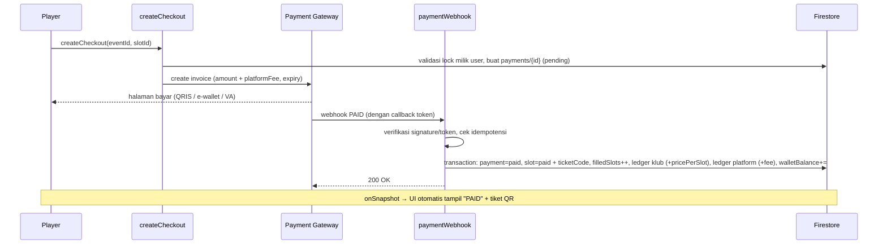

# KickPro — Arsitektur Sistem

> Dokumen ini turunan dari [prd.md](./prd.md). Stack awal: **Next.js (React) + Firebase**.
> Dokumen terkait: [modules.md](./modules.md) (daftar modul) · [tasks.md](./tasks.md) (todo & penjelasan task).

---

## 1. Prinsip Arsitektur

1. **Mobile-first web** — mayoritas pemain masuk dari link WhatsApp, jadi halaman publik event harus cepat, ringan, dan punya preview link (Open Graph) yang bagus.
2. **Client membaca, server menulis data sensitif** — UI boleh baca Firestore langsung (realtime), tapi semua operasi yang menyangkut **slot, uang, status match, dan skor** hanya dijalankan di server (Cloud Functions) dengan Admin SDK.
3. **Uang = ledger immutable** — setiap pergerakan dana dicatat sebagai entri ledger yang tidak pernah diubah/dihapus. Saldo (`walletBalance`) hanya cache yang diperbarui server.
4. **Idempotent by default** — webhook payment bisa dikirim berulang kali; semua handler wajib aman dipanggil >1 kali.
5. **Satu sumber tipe data** — tipe TypeScript & skema validasi (Zod) dipakai bersama oleh web dan functions.

---

## 2. Tech Stack

| Layer | Pilihan | Alasan |
| --- | --- | --- |
| Frontend | **Next.js 15 (App Router) + React + TypeScript** | SSR untuk halaman event publik (preview WA & SEO), RSC, routing modern |
| UI | **Tailwind CSS + shadcn/ui**, `lucide-react` | Cepat dibangun, aksesibel, mudah dikustom |
| Form & Validasi | `react-hook-form` + **Zod** | Skema Zod di-share ke backend |
| Data fetching client | Firebase JS SDK (`onSnapshot`) + TanStack Query | Realtime slot indicator + caching |
| Auth | **Firebase Authentication** (Phone OTP + Google) | Pengguna Indonesia terbiasa login pakai nomor HP |
| Database | **Cloud Firestore** | Realtime, sesuai skema PRD |
| File | **Cloud Storage for Firebase** | Logo klub, galeri, bukti booking lapangan |
| Backend logic | **Cloud Functions for Firebase (2nd gen, Node 20, TS)** | Callable, HTTP webhook, scheduler, Firestore trigger |
| Hosting | **Firebase App Hosting** (Next.js SSR) | Native support Next.js, terintegrasi dengan Firebase |
| Notifikasi | **Firebase Cloud Messaging (FCM)** + share link WhatsApp (`wa.me`) | MVP tanpa WhatsApp Business API |
| Payment | **Xendit** (rekomendasi) atau Midtrans | QRIS, e-wallet, VA, **Disbursement**, dan sub-account (xenPlatform) untuk dompet klub |
| Anti-abuse | **Firebase App Check** (reCAPTCHA Enterprise) | Melindungi callable functions |
| Monitoring | Cloud Logging, Sentry, Firebase Analytics | Error tracking & funnel KPI |
| Tooling | pnpm workspace, ESLint, Prettier, Vitest, Playwright, Firebase Emulator Suite, GitHub Actions | DX & CI |

> [!WARNING]
> **Regulasi dana (escrow & dompet klub).** Menampung dana pihak ketiga di Indonesia diatur BI/OJK. Untuk MVP, **jangan menyimpan dana di rekening sendiri** — gunakan fitur *sub-account / managed account* dari payment gateway berlisensi (mis. Xendit xenPlatform) sehingga "saldo dompet" & "escrow" secara legal berada di PJP berlisensi, sementara KickPro hanya mencatat ledger-nya. Konsultasikan dengan legal sebelum go-live.

---

## 3. Gambaran Arsitektur



### Pembagian tanggung jawab

| Komponen | Tanggung jawab |
| --- | --- |
| **Next.js** | Render UI, SSR halaman publik (`/e/[eventId]`, `/c/[clubSlug]`), OG image dinamis, proteksi route berdasarkan session cookie |
| **Firestore (client SDK)** | Baca realtime: slot, daftar event, sparring board, ledger klub (sesuai security rules) |
| **Cloud Functions** | Semua *write* sensitif: lock/unlock slot, buat invoice, webhook payment, ledger, payout, escrow, update attendance score, rating |
| **Security Rules** | Garis pertahanan terakhir: client tidak boleh menulis field finansial/status |

---

## 4. Struktur Repository (Monorepo)

```
kickpro/
├── apps/
│   └── web/                      # Next.js 15
│       ├── app/
│       │   ├── (public)/         # landing, /e/[eventId], /c/[clubSlug]
│       │   ├── (auth)/           # login, onboarding
│       │   ├── (player)/         # explore, my-tickets, profile
│       │   ├── (club)/club/[clubId]/  # dashboard, events, sparring, wallet, members
│       │   └── api/              # route handlers (session cookie, og image)
│       ├── components/           # ui/ (shadcn), shared, feature components
│       ├── features/             # per modul: events/, slots/, sparring/, wallet/ ...
│       ├── lib/firebase/         # client.ts, admin.ts, converters.ts
│       └── hooks/
├── functions/                    # Cloud Functions (TypeScript)
│   └── src/
│       ├── callable/             # lockSlot, createCheckout, createEvent, ...
│       ├── http/                 # paymentWebhook
│       ├── scheduled/            # releaseExpiredLocks, sparringDeadlineJob
│       ├── triggers/             # onPaymentPaid, onEventCompleted
│       ├── services/             # ledger, payment-gateway, notification
│       └── index.ts
├── packages/
│   └── shared/                   # tipe TS, Zod schema, konstanta (fee, status enum)
├── firestore.rules
├── firestore.indexes.json
├── storage.rules
├── firebase.json
├── apphosting.yaml
└── docs/
```

---

## 5. Model Data Firestore (Revisi dari PRD)

Skema PRD dipertahankan, dengan tambahan yang diperlukan agar flow uang, tim, dan sparring bisa berjalan.

> [!IMPORTANT]
> Semua nominal uang disimpan sebagai **integer rupiah** (`number`, tanpa desimal). Semua waktu event disimpan sebagai `Timestamp` (`startAt`, `endAt`) zona `Asia/Jakarta`, field string `eventDate/startTime` dari PRD boleh dipertahankan untuk tampilan.

```
users/{userId}
  name, phoneNumber, photoUrl, city, geo{lat,lng,geohash}
  position: "GK"|"DF"|"MF"|"FW", preferredFoot, favoriteNumber
  attendanceScore (0-100), stats{ matchesPlayed, minutesPlayed, mvpCount, noShowCount }
  platformRole: "user" | "superadmin"          # role per-klub ada di members/
  fcmTokens: string[], createdAt

clubs/{clubId}
  name, slug, logoUrl, city, geo, description, vision, sportTypes[]
  level: "beginner"|"fun"|"competitive", avgAge
  walletBalance (cache, server-only), escrowBalance (cache)
  totalMatchesPlayed, fairPlayScore, fairPlayCount
  subscription{ plan: "free"|"club_pass", validUntil }
  pgSubAccountId                                 # id sub-account payment gateway
  ├── members/{userId}   role: "head_admin"|"treasurer"|"event_host"|"member", joinedAt, status
  ├── joinRequests/{userId}  message, status: "pending"|"approved"|"rejected"
  ├── ledger/{entryId}   type, direction: "in"|"out", amount, balanceAfter,
  │                      refType: "event"|"sparring"|"expense"|"payout"|"fee", refId,
  │                      note, attachmentUrl, createdBy, createdAt   # immutable
  ├── payouts/{payoutId} amount, bankCode, accountNumber, status, pgPayoutId, requestedBy
  └── gallery/{photoId}

events/{eventId}                    # mabar / open play
  clubId, title, sportType, level, venueName, venueAddress, venueGeo{geohash}
  bookingProofUrl                   # bukti pesan lapangan (wajib jika venue di luar KickPro)
  startAt, endAt, eventDate, startTime, endTime
  teamCount, playersPerTeam, totalSlots (= teamCount × playersPerTeam)
  pricePerSlot, platformFee, filledSlots, lockedSlots
  status: "draft"|"open"|"full"|"completed"|"cancelled"
  cancellationPolicy{ refundUntilHours }
  ├── teams/{teamId}     name, color, index
  └── slots/{slotId}     slotNumber, teamId, position, status: "available"|"locked"|"paid"|"checked_in"|"no_show"
                         lockedByUserId, lockExpiresAt, userId, playerName, playerPhone,
                         paymentId, ticketCode, checkedInAt

payments/{paymentId}               # satu dokumen per invoice ke payment gateway
  type: "slot"|"sparring_deposit"|"subscription"
  userId, clubId, refPath, amount, platformFee, grossAmount
  pgProvider, pgInvoiceId, pgStatus, method, status: "pending"|"paid"|"expired"|"refunded"
  idempotencyKey, paidAt, rawWebhook (opsional, untuk audit), createdAt

sparring_matches/{matchId}
  hostClubId, challengerClubId, sportType, format: "7v7"|"8v8"|"11v11"
  venueName, venueAddress, bookingProofUrl, matchDate, matchTime, startAt
  totalFieldCost, splitRatio{host:50, challenger:50}, adminFee
  hasReferee, hasPhotographer, cancelDeadlineHours (default 24)
  hostDepositPaid, challengerDepositPaid
  status: "open"|"challenge_pending"|"negotiating"|"awaiting_deposit"|"confirmed"|"completed"|"cancelled"|"disputed"
  result{ hostScore, challengerScore, confirmedByHost, confirmedByChallenger }
  ├── challenges/{clubId}   message, status: "pending"|"accepted"|"rejected"
  ├── proposals/{proposalId} clubId, options[{ venue, startAt }]   # usulan jadwal & tempat
  └── ratings/{clubId}       fairPlay (1-5), comment

notifications/{userId}/items/{id}   # inbox in-app
leagues/{leagueId} ...              # Fase 3 (lihat modules.md)
```

### Index penting (`firestore.indexes.json`)
- `events`: `status ASC, sportType ASC, startAt ASC`; `status, venueGeo.geohash, startAt`; `clubId, startAt DESC`
- `sparring_matches`: `status, sportType, startAt`; `hostClubId, startAt DESC`
- `ledger` (collection group bila perlu): `createdAt DESC`

### Pencarian geolokasi
Firestore tidak mendukung query radius native → gunakan **geohash** (`geofire-common`): query rentang geohash lalu filter jarak di client. Jika nanti butuh full-text/filter kompleks, tambahkan **Algolia / Typesense** via extension.

---

## 6. Flow Kritis & Desain Teknis

### 6.1 Auto-Lock Slot 10 Menit (anti-serobot)



- Batas **1 lock aktif per user per event** (cegah borong slot).
- Lock yang kadaluarsa dianggap bebas di dalam transaksi (*lazy expiry*), scheduler hanya bersih-bersih → tidak tergantung presisi cron.
- Invoice payment gateway dibuat dengan `expiry = lockExpiresAt` agar sinkron.

### 6.2 Checkout & Webhook Payment



- **Edge case**: pembayaran masuk setelah lock kadaluarsa & slot sudah diambil orang lain → tandai `payment.status = "paid_orphan"` dan **refund otomatis** / tawarkan slot lain.
- Webhook selalu mengembalikan 200 setelah dicatat; proses berat via trigger `onPaymentPaid` bila perlu.

### 6.3 Ledger & Dompet Klub
- Semua perubahan saldo lewat satu service `ledger.post({clubId, direction, amount, refType, refId})` di dalam Firestore transaction yang juga meng-update `walletBalance`.
- Pengeluaran manual (beli bola, rompi, dsb.) diinput Treasurer → tercatat sebagai ledger `out` dengan lampiran foto nota.
- Payout: Treasurer/Head Admin request → validasi saldo → hold (`ledger out` status pending) → API disbursement → webhook sukses/gagal (gagal = reversal entry).

### 6.4 Sparring: Matching Jadwal & Escrow
1. Host publish match (dengan atau tanpa slot lapangan fix + bukti booking).
2. Challenger "Ajukan Tanding" → host menerima satu challenger.
3. Jika jadwal belum fix: kedua tim submit `proposals` (beberapa opsi venue + waktu) → function `computeMatchOptions` mencari irisan (venue sama/berdekatan & waktu overlap) → daftar opsi yang cocok.
4. Kedua kapten konfirmasi satu opsi → status `awaiting_deposit` → masing-masing bayar deposit (porsi sewa + admin fee) via payment gateway.
5. Kedua deposit lunas → `confirmed`.
6. **Pembatalan**: scheduler/callable cek `now < startAt - cancelDeadlineHours`:
   - Sebelum batas: refund deposit (dikurangi admin fee).
   - Lewat batas (ghosting): deposit tim pembatal dialihkan ke tim lawan sebagai ganti rugi.
7. Pasca laga: kedua kapten input skor + Fair Play Rating → jika skor cocok `completed`, dana sewa dicairkan ke host/venue; jika beda → `disputed` (review manual superadmin).

### 6.5 Tiket QR & Presensi
- `ticketCode` = token acak + HMAC (server secret) → dirender sebagai QR di "My Tickets".
- Event Host scan via kamera (halaman `/club/[clubId]/events/[eventId]/check-in`) → callable `checkInSlot` → `checked_in`.
- Saat event `completed`: slot `paid` yang tidak check-in → `no_show` → trigger update `attendanceScore` pemain.

### 6.6 Smart WhatsApp Generator
- MVP: generate teks rekap (judul, venue, jam, daftar pemain per tim, slot tersisa, link) → tombol **Copy** & **Share ke WhatsApp** (`https://wa.me/?text=...`).
- Halaman `/e/[eventId]` punya OG image dinamis (`next/og`) agar preview di grup WA menarik.
- Fase lanjut: WhatsApp Business API (mis. via Qontak/Wati) untuk broadcast otomatis.

---

## 7. Keamanan

| Area | Kontrol |
| --- | --- |
| Auth | Firebase Auth (Phone OTP + Google); session cookie httpOnly untuk SSR route terproteksi |
| Otorisasi klub | Role di `clubs/{id}/members/{uid}`; dicek di Security Rules & setiap callable. Opsional: custom claims untuk caching |
| Security Rules | Client **read-only** untuk `slots`, `payments`, `ledger`, `walletBalance`, `status` match; `users/{uid}` hanya bisa diedit pemiliknya (kecuali field statistik/score) |
| Webhook | Verifikasi callback token/signature, allowlist IP gateway bila tersedia, idempotency key |
| Abuse | App Check di callable, rate limit lock slot per user, 1 lock aktif per event |
| Secrets | Cloud Secret Manager (`defineSecret`) untuk API key gateway & HMAC secret |
| Data pribadi | Nomor HP pemain hanya terlihat oleh admin klub penyelenggara (UU PDP) |

---

## 8. Environment & Deployment

| Env | Firebase Project | Region | Payment Gateway | Deploy |
| --- | --- | --- | --- | --- |
| local | `demo-kickpro` (Emulator Suite) | Lokal (`127.0.0.1`) | Sandbox / mock webhook | `pnpm dev:all` |
| staging | `kickpro-staging` | `asia-southeast2` (Jakarta) | Sandbox | otomatis dari branch `develop` |
| production | `kickpro-prod` | `asia-southeast2` (Jakarta) | Live | otomatis dari tag/branch `main` (dengan approval) |

CI (GitHub Actions): lint → typecheck → unit test (Vitest) → rules test (`@firebase/rules-unit-testing`) → build → deploy (App Hosting + Functions + Rules + Indexes).

---

## 9. Keputusan Terbuka (perlu dikonfirmasi)

1. **Payment gateway**: Xendit (xenPlatform + disbursement) vs Midtrans (Iris untuk payout). Rekomendasi: Xendit.
2. **Login**: Phone OTP (biaya SMS Firebase) vs WhatsApp OTP pihak ketiga — atau Google login sebagai default untuk menekan biaya.
3. **Checkout tanpa login?** Untuk menaikkan conversion dari link WA, opsi *guest checkout* (nama + no. HP) lalu akun dibuat otomatis.
4. **Venue internal KickPro**: PRD menyebut "jika belum ada lapangan di KickPro" → apakah modul Venue (booking lapangan) masuk roadmap? Saat ini dianggap Fase 3.
