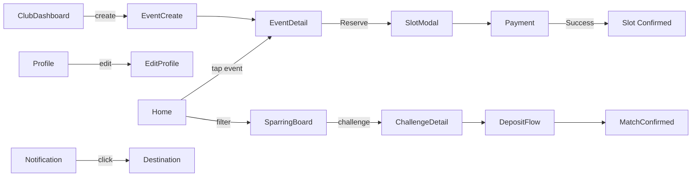

# KickPro UI Design Overview

## 1. Visual Language & Design System
- **Color palette** – Primary: `#0066FF` (KickPro Blue) ; Secondary: `#00C853` (Success Green) ; Accent: `#FF9800` (Warning Orange).  
- **Typography** – Roboto (Headings) + Inter (Body).  
- **Iconography** – Material Icons, customized for football (ball, whistle, trophy).  
- **Spacing** – 8‑px baseline grid, rounded‑corner cards (4‑8 px radius).
- **Components** – Re‑usable shadcn/ui‑style components (Button, Card, Dialog, Tabs, Avatar, Badge, Toast).  
- **Dark mode** – Optional toggle; dark background `#121212` with accent highlights.

---

## 2. Core Screens (Mobile‑first, responsive for web)

### 2.1 Home / Event Feed
```
+---------------------------------------------------+
|  Top Bar – Logo | Search | Profile Avatar         |
+---------------------------------------------------+
|  Filter Tabs: All | Open Play | Sparring | Club |
+---------------------------------------------------+
|  Event Card (list) – shows thumbnail, title,      |
|  sport type, date, time, price, live‑slot indicator |
+---------------------------------------------------+
|  Pull‑to‑refresh & infinite scroll               |
+---------------------------------------------------+
```
- **Live slot indicator**: small dot + "12/20" badge; color changes to red when <5 slots left.
- **Swipe actions**: swipe left → "Save" (bookmark); swipe right → "Share".

### 2.2 Event Detail
```
+---------------------------------------------------+
|  Header Image (venue)                             |
|  Event Title                                      |
|  Club Avatar + Name                               |
+---------------------------------------------------+
|  Tabs: Overview | Slots | Players | Chat        |
+---------------------------------------------------+
|  Overview section – description, rules, map link |
+---------------------------------------------------+
|  Slots Grid – 2‑column cards showing slot number |
|  status (available/locked/paid) with countdown    |
+---------------------------------------------------+
|  Action Button: "Reserve Slot" (primary)         |
+---------------------------------------------------+
```
- **Slot card** shows timer when locked (e.g., `09:45` remaining).
- **Chat** integrates with WhatsApp API via a "Open WhatsApp" button.

### 2.3 Slot Reservation Flow (Modal)
```
+---------------------------+
|  Select Position (optional) |
|  Choose Slot Number          |
|  Review Price                |
|  Countdown 10 min            |
|  [Pay Now]   [Cancel]        |
+---------------------------+
```
- countdown runs client‑side; auto‑release via Firestore TTL on backend.

### 2.4 Payment Screen
- Full‑screen QR code for QRIS/GoPay, plus **Copy Payment Link** button.
- Integration with payment gateway web‑hook; shows **"Waiting for confirmation..."** with animated spinner.
- On success → toast **"Payment successful! Slot confirmed."** and auto‑navigate back to Event Detail.

### 2.5 My Profile (Player)
```
+---------------------------+
| Avatar + Name             |
| Position • Preferred Foot |
| Attendance Score (progress bar) |
| Stats: Matches Played, MVPs |
| Button: Edit Profile      |
+---------------------------+
| Tabs: Upcoming Slots | History | Payments |
+---------------------------+
```
- Upcoming Slots list with status and quick‑cancel (if still locked).

### 2.6 Club Dashboard (Host/Admin)
```
+---------------------------------------------------+
|  Club Header – Logo, Name, Balance               |
+---------------------------------------------------+
|  Nav Tabs: Events | Roster | Wallet | Reports   |
+---------------------------------------------------+
|  Events Table – create new (+) button, filter by |
|  status, date. Each row shows slots filled/total |
+---------------------------------------------------+
|  Roster Card – member list with role selector    |
+---------------------------------------------------+
|  Wallet Section – total balance, pending escrow, |
|  "Request Payout" button                         |
+---------------------------------------------------+
|  Reports – quick charts (daily revenue,      |
|  dispute rate)                                    |
+---------------------------------------------------+
```
- Buttons use **shadcn/ui** styled dialogs for creating/editing events.

### 2.7 Sparring Board
```
+---------------------------------------------------+
|  Filter: Region | Date | Format | Level           |
+---------------------------------------------------+
|  Challenge Card – host club, venue, date, price, |
|  "View Details" button                         |
+---------------------------------------------------+
|  Challenger can tap "Ajukan Tanding" → modal      |
|  with optional message and deposit preview       |
+---------------------------------------------------+
```
- Card background changes to green when both deposits are paid.

### 2.8 Notification Center
- Unified list (in‑app) with icons: 🔔 for new matches, 💰 for wallet updates, 📅 for upcoming events.
- Swipe‑to‑dismiss; tap opens relevant screen.

---

## 3. Navigation Flow (Mermaid)


---

## 4. Responsiveness & Accessibility
- Breakpoints: <576 px (mobile), 576‑992 px (tablet), >992 px (desktop).  
- Buttons minimum 44 px tap area, sufficient contrast (>4.5:1).  
- All images have `alt` text; ARIA labels on interactive elements.  
- Keyboard navigation supported on web version.

---

## 5. Prototypes & Handoff
- Use **Figma** (or the built‑in `design` skill) to create high‑fidelity prototypes based on the wireframes above.  
- Export component library as a **React + Tailwind** package (`ui-ux-pro-max` skill can scaffold the code).  
- Link the prototype in the repository under `design/kickpro_figma.fig`.  

---

*Catatan:* Desain ini mengikuti prinsip **mobile‑first** dan dapat di‑scale ke versi web responsif. Semua komponen dirancang untuk dapat di‑implementasikan dengan **shadcn/ui** (Tailwind + Radix) sehingga mempercepat pengembangan front‑end.

---

*Generated by Antigravity – see the artifact `kickpro_ui_design.md` for the full markdown file.*