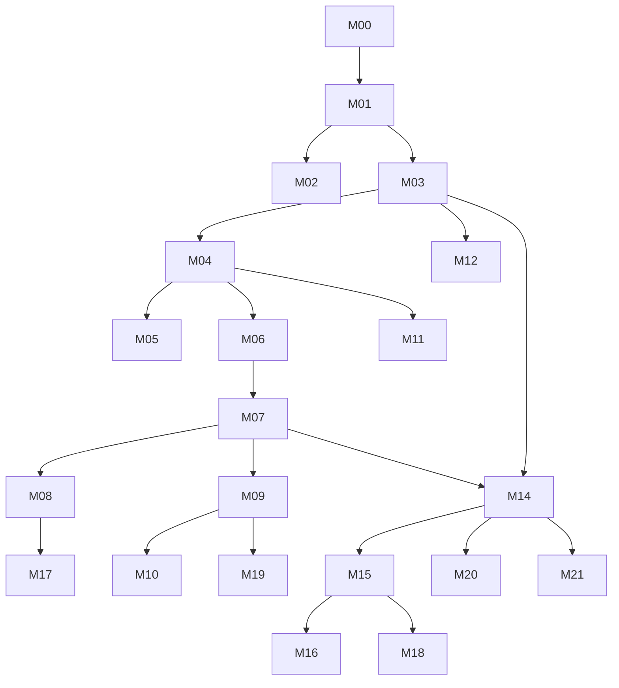

# KickPro — Daftar Modul

> Referensi: [prd.md](./prd.md) · [architecture.md](./architecture.md) · [tasks.md](./tasks.md)

## Ringkasan Modul & Fase

| Kode | Modul | Mode | Fase | Prioritas |
| --- | --- | --- | --- | --- |
| M00 | Fondasi Proyek & Infrastruktur | — | 0 | P0 |
| M01 | Auth & Onboarding | Semua | 1 | P0 |
| M02 | Profil Pemain & Player Card | Player | 1 | P0 |
| M03 | Klub, Anggota & Roster | Club | 1 | P0 |
| M04 | Event Mabar (Event Creator & Tim) | Club | 1 | P0 |
| M05 | Eksplorasi Event (Feed & Filter) | Player | 1 | P0 |
| M06 | Reservasi Slot & Auto-Lock | Player | 1 | P0 |
| M07 | Payment Gateway & Checkout | Semua | 1 | P0 |
| M08 | Tiket Digital, QR & Presensi | Player + Club | 1 | P1 |
| M09 | Dompet Klub & Buku Kas (Ledger) | Club | 1 | P0 |
| M10 | Payout / Pencairan Saldo | Club | 1 | P1 |
| M11 | Smart WhatsApp Generator & Share | Club | 1 | P0 |
| M12 | Direktori Komunitas & Join Request | Player | 1 | P1 |
| M13 | Notifikasi (In-app & Push) | Semua | 1 | P2 |
| M14 | Sparring Board & Matchmaking | Club | 2 | P0 (fase 2) |
| M15 | Escrow & Anti-Ghosting | Club | 2 | P0 (fase 2) |
| M16 | Pasca Laga: Skor & Fair Play Rating | Club | 2 | P1 |
| M17 | Attendance Score & Statistik Otomatis | Player | 2 | P1 |
| M18 | Admin Panel (Superadmin) & Dispute | Internal | 2 | P1 |
| M19 | KickPro Club Pass (Subscription SaaS) | Club | 3 | P2 |
| M20 | Liga Antar Komunitas | Club | 3 | P2 |
| M21 | Marketplace Wasit & Fotografer | Club | 3 | P3 |
| M22 | Analytics, Monitoring & KPI | Internal | 0–3 | P1 |

**Definisi fase**
- **Fase 0 — Fondasi**: repo, Firebase, CI, design system.
- **Fase 1 — MVP Mabar & Kas**: admin bisa membuat event, share ke WA, pemain pilih slot & bayar otomatis, uang tercatat di kas klub. *(Menjawab KPI #1 & #4)*
- **Fase 2 — Sparring & Escrow**: papan sparring, matching jadwal, deposit escrow, anti-ghosting. *(Menjawab KPI #2)*
- **Fase 3 — Monetisasi lanjutan & Liga**: Club Pass, liga, marketplace. *(Menjawab KPI #3)*

---

## Detail Modul

### M00 — Fondasi Proyek & Infrastruktur
Monorepo (pnpm), Next.js 15, Cloud Functions TS, package `shared`, Firebase project (staging/prod), Emulator Suite, Security Rules dasar, CI/CD, design system (Tailwind + shadcn/ui), layout mobile-first.
**Output**: aplikasi kosong yang bisa di-deploy, login dummy berjalan di emulator.

### M01 — Auth & Onboarding
Login Phone OTP + Google, session cookie untuk SSR, middleware proteksi route, onboarding (nama, kota, posisi, kaki dominan), pemilihan mode Player / Club (switcher, karena satu user bisa jadi pemain sekaligus admin klub).
**Collections**: `users`.

### M02 — Profil Pemain & Player Card
Kartu profil digital (posisi, kaki, nomor punggung), riwayat mabar, jam terbang, MVP, indeks disiplin, halaman profil publik yang bisa dibagikan.
**Collections**: `users`, query `slots` (collection group) untuk riwayat.

### M03 — Klub, Anggota & Roster
Buat klub (nama, slug, logo, kota, level, visi), dashboard klub, daftar anggota, undang anggota, pembagian peran **Head Admin / Treasurer / Event Host / Member**, matriks hak akses.
**Collections**: `clubs`, `clubs/{id}/members`.

| Aksi | Head Admin | Treasurer | Event Host | Member |
| --- | :-: | :-: | :-: | :-: |
| Edit profil klub & peran | ✅ | — | — | — |
| Buat/kelola event & check-in | ✅ | — | ✅ | — |
| Input pengeluaran kas | ✅ | ✅ | — | — |
| Request payout | ✅ | ✅ | — | — |
| Lihat buku kas | ✅ | ✅ | ✅ | ✅ (transparansi) |
| Buka/terima sparring | ✅ | — | ✅ | — |

### M04 — Event Mabar (Event Creator & Tim)
Form cepat: venue, upload bukti booking lapangan, tanggal/jam, sport type, level, **jumlah tim × pemain per tim → total slot otomatis**, iuran per orang, kebijakan pembatalan. Generate dokumen `teams` & `slots`. Edit, tutup, batalkan (dengan refund massal), duplikasi event rutin mingguan. Daftar peserta (presensi otomatis).
**Collections**: `events`, `events/{id}/teams`, `events/{id}/slots`.

### M05 — Eksplorasi Event (Feed & Filter)
Feed event terdekat (geohash/radius), filter sport type, tanggal/jam, rentang harga, level, live slot indicator (realtime). Halaman detail event publik SSR `/e/[eventId]` dengan OG image.

### M06 — Reservasi Slot & Auto-Lock
Visual papan slot per tim + pilihan posisi, callable `lockSlot` (transaction), countdown 10 menit, `releaseSlot` manual, scheduler `releaseExpiredLocks`, batas 1 lock/user/event.

### M07 — Payment Gateway & Checkout
Abstraksi `PaymentProvider` (Xendit/Midtrans), `createCheckout` (invoice dengan expiry = lock), halaman status pembayaran, `paymentWebhook` (verifikasi + idempotensi), refund, perhitungan convenience fee (Rp2.000–3.000), penanganan *paid orphan*.
**Collections**: `payments`.

### M08 — Tiket Digital, QR & Presensi
"My Tickets" berisi QR (ticketCode ber-HMAC), scanner QR untuk Event Host, check-in manual fallback, penandaan `no_show` saat event selesai.

### M09 — Dompet Klub & Buku Kas (Ledger)
Service ledger immutable, saldo dompet, mutasi masuk (iuran event) otomatis, input pengeluaran manual + foto nota, kategori pengeluaran, laporan per periode/per event, export CSV/PDF, tampilan transparansi untuk anggota.
**Collections**: `clubs/{id}/ledger`.

### M10 — Payout / Pencairan Saldo
Simpan rekening bank tujuan (validasi nama pemilik bila didukung gateway), request payout, approval (opsional 2 peran), disbursement API, webhook status, reversal bila gagal, biaya pencairan (gratis untuk Club Pass).
**Collections**: `clubs/{id}/payouts`.

### M11 — Smart WhatsApp Generator & Share
Template teks pengumuman event, rekap peserta per tim, sisa slot, reminder H-1; tombol copy & `wa.me` share; OG image dinamis.

### M12 — Direktori Komunitas & Join Request
List & cari klub per kota, profil publik klub `/c/[slug]` (jadwal rutin, galeri, visi, statistik), tombol Join Request, approval oleh admin.
**Collections**: `clubs/{id}/joinRequests`, `clubs/{id}/gallery`.

### M13 — Notifikasi
Inbox in-app, FCM push (slot terbayar, event besok, tantangan sparring masuk, deposit diperlukan), preferensi notifikasi.

### M14 — Sparring Board & Matchmaking
Host Match (format 7v7/8v8/11v11, wasit/fotografer, skema patungan), Sparring Board (filter wilayah, tanggal, level), detail tim (rekam jejak, rata-rata usia, level, fair play), "Ajukan Tanding", terima/tolak challenger, **proposal jadwal & tempat dari kedua tim → algoritma pencocokan** → konfirmasi kedua kapten.
**Collections**: `sparring_matches` + sub `challenges`, `proposals`.

### M15 — Escrow & Anti-Ghosting
Deposit kedua tim via payment gateway, status `awaiting_deposit → confirmed`, batas waktu pembatalan (default H-1), refund vs kompensasi otomatis ke tim lawan, admin fee sparring (Rp15–25rb/tim), pencairan sewa ke host setelah laga.

### M16 — Pasca Laga: Skor & Fair Play Rating
Input skor oleh kedua kapten, rekonsiliasi (cocok → completed, beda → disputed), Fair Play Rating 1–5 + komentar, update `fairPlayScore` & `totalMatchesPlayed` klub.

### M17 — Attendance Score & Statistik Otomatis
Trigger saat event/match selesai: hitung `attendanceScore` (hadir / total terdaftar, dengan bobot pembatalan mendadak), jam terbang, jumlah main, pemilihan MVP sesi oleh host. Opsional: batasi pemain dengan skor rendah di event kompetitif.

### M18 — Admin Panel (Superadmin) & Dispute
Dashboard internal: daftar transaksi, refund manual, resolusi dispute sparring, moderasi klub/event, verifikasi bukti booking, audit ledger.

### M19 — KickPro Club Pass (Subscription)
Paket Free vs Club Pass (Rp99–199rb/bulan): buku kas lengkap & export, gratis biaya payout, verified badge. Pembayaran berulang (recurring invoice), feature gating.

### M20 — Liga Antar Komunitas
Buat liga/turnamen, slot pendaftaran klub, biaya pendaftaran, jadwal otomatis (round-robin/knockout), klasemen, input hasil. Dibangun di atas infrastruktur sparring (M14–M16).
**Collections**: `leagues`, `leagues/{id}/teams`, `leagues/{id}/fixtures`.

### M21 — Marketplace Wasit & Fotografer
Profil mitra (wasit/fotografer), kalender ketersediaan, booking yang dilampirkan ke event/sparring, komisi 10–15%, rating mitra.

### M22 — Analytics, Monitoring & KPI
Firebase Analytics event (lock_slot, checkout_start, payment_success), dashboard KPI (Transaction Completion Rate, Zero Dispute Matchmaking, cashflow), Sentry, alert error webhook.
