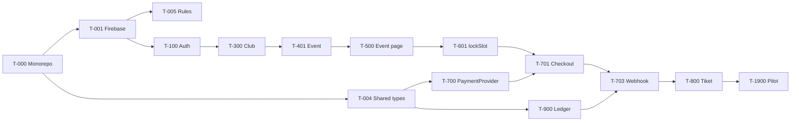

# KickPro — Todo Task & Penjelasan

> Referensi: [prd.md](./prd.md) · [architecture.md](./architecture.md) · [modules.md](./modules.md)
>
> **Format task**: `ID` — judul · *estimasi (hari kerja, 1 dev)* · `dep:` task prasyarat
> Setiap task berisi **Penjelasan** (apa & kenapa) dan **Selesai jika** (acceptance criteria).
> Centang `[x]` saat selesai.

---

## FASE 0 — Fondasi

### M00 · Fondasi Proyek & Infrastruktur

- [x] **T-000 — Inisialisasi monorepo** · *0.5 hari*
  - **Penjelasan**: Buat pnpm workspace dengan `apps/web` (Next.js 15, App Router, TypeScript strict), `functions/` (Cloud Functions TS), `packages/shared`. Setup ESLint, Prettier, path alias, `.editorconfig`, `.nvmrc` (Node 20).
  - **Selesai jika**: `pnpm install`, `pnpm lint`, `pnpm typecheck` lulus di root; `apps/web` bisa `pnpm dev`.

- [x] **T-001 — Setup Firebase project (staging & prod)** · *0.5 hari* · `dep: T-000`
  - **Penjelasan**: Buat project `kickpro-staging` & `kickpro-prod`, aktifkan Auth, Firestore (region `asia-southeast2` Jakarta), Storage, Functions, App Hosting. Buat `firebase.json`, `.firebaserc` dengan alias.
  - **Selesai jika**: `firebase use staging` dan `firebase use prod` berfungsi; region tercatat di dokumen.

- [x] **T-002 — Firebase Emulator Suite & seed data** · *1 hari* · `dep: T-001`
  - **Penjelasan**: Konfigurasi emulator Auth, Firestore, Functions, Storage. Buat script `pnpm seed` yang mengisi user, klub, event, dan slot contoh agar developer bisa langsung mencoba flow.
  - **Selesai jika**: `pnpm dev:all` menyalakan Next.js + emulator; data seed tampil di Emulator UI.

- [x] **T-003 — Firebase client & admin SDK wrapper** · *0.5 hari* · `dep: T-001`
  - **Penjelasan**: `lib/firebase/client.ts` (singleton, auto-connect emulator di dev), `lib/firebase/admin.ts` (server only, untuk SSR & route handler), Firestore converters bertipe dari `packages/shared`.
  - **Selesai jika**: Komponen server dan client bisa membaca koleksi `events` dengan tipe yang benar.

- [x] **T-004 — Package `shared`: tipe, enum, Zod schema** · *1 hari* · `dep: T-000`
  - **Penjelasan**: Definisikan semua tipe dokumen di [architecture.md §5](./architecture.md) beserta Zod schema & konstanta (status enum, fee, durasi lock 10 menit, cancel deadline). Dipakai web & functions agar tidak ada drift.
  - **Selesai jika**: Web & functions meng-import dari `@kickpro/shared` tanpa error build.

- [x] **T-005 — Security Rules baseline + test** · *1 hari* · `dep: T-002, T-004`
  - **Penjelasan**: Deny-by-default. Helper `isSignedIn()`, `isClubRole(clubId, roles)`. Field finansial & status hanya bisa ditulis Admin SDK. Tulis test dengan `@firebase/rules-unit-testing`.
  - **Selesai jika**: Test rules berjalan di CI; user biasa gagal menulis `walletBalance`/`slots.status`.

- [x] **T-006 — Design system & layout mobile-first** · *2 hari* · `dep: T-000`
  - **Penjelasan**: Tailwind + shadcn/ui, token warna/tipografi brand KickPro, komponen dasar (Button, Card, Sheet, Dialog, Badge status, Skeleton, Toast), layout dengan bottom navigation untuk Player Mode & sidebar/top-bar untuk Club Mode.
  - **Selesai jika**: Halaman `/design` (dev only) menampilkan semua komponen; lolos Lighthouse a11y ≥ 90.

- [x] **T-007 — CI/CD GitHub Actions** · *1 hari* · `dep: T-005`
  - **Penjelasan**: Pipeline lint → typecheck → unit test → rules test → build. Deploy otomatis ke staging dari `develop`, ke prod dari `main` dengan manual approval. Secrets via GitHub Environments & Secret Manager.
  - **Selesai jika**: PR menampilkan status check; merge ke `develop` men-deploy staging.

- [x] **T-008 — Monitoring dasar** · *0.5 hari* · `dep: T-007`
  - **Penjelasan**: Sentry untuk web & functions, structured logging di functions (`logger`), Firebase Analytics init.
  - **Selesai jika**: Error sengaja di staging muncul di Sentry dengan source map.

---

## FASE 1 — MVP Mabar, Pembayaran & Kas

### M01 · Auth & Onboarding

- [ ] **T-100 — Login Phone OTP & Google** · *1.5 hari* · `dep: T-003, T-006`
  - **Penjelasan**: Halaman `/login` dengan input nomor HP format Indonesia (+62), reCAPTCHA invisible, verifikasi OTP; alternatif Google Sign-In. Normalisasi nomor (08xx → +628xx).
  - **Selesai jika**: User bisa login di emulator & staging; nomor tersimpan dalam format E.164.

- [ ] **T-101 — Session cookie & proteksi route** · *1 hari* · `dep: T-100`
  - **Penjelasan**: Route handler `/api/session` menukar ID token → session cookie httpOnly (Admin SDK). `middleware.ts` melindungi grup `(player)` & `(club)`; redirect ke `/login?next=...`.
  - **Selesai jika**: Refresh halaman terproteksi tetap login (SSR); logout menghapus cookie.

- [ ] **T-102 — Trigger `onUserCreate` & onboarding** · *1 hari* · `dep: T-101`
  - **Penjelasan**: Function membuat dokumen `users/{uid}` default (attendanceScore 100). Halaman onboarding: nama, kota, posisi, kaki dominan, nomor punggung favorit.
  - **Selesai jika**: User baru wajib menyelesaikan onboarding sebelum masuk app.

- [ ] **T-103 — Mode switcher Player ↔ Club** · *0.5 hari* · `dep: T-102, T-301`
  - **Penjelasan**: Satu akun bisa menjadi pemain sekaligus admin beberapa klub. Switcher di header menampilkan klub yang dikelola (dari `members` dengan role non-member).
  - **Selesai jika**: User admin bisa berpindah ke dashboard klub tanpa login ulang.

### M02 · Profil Pemain & Player Card

- [ ] **T-200 — Halaman profil & edit profil** · *1 hari* · `dep: T-102`
  - **Penjelasan**: Lihat & ubah data profil, upload foto (Storage, resize di client). Field statistik read-only.
  - **Selesai jika**: Perubahan tersimpan; rules menolak update field statistik dari client.

- [ ] **T-201 — Komponen Player Card** · *1 hari* · `dep: T-200`
  - **Penjelasan**: Kartu bergaya "kartu pemain" (posisi, kaki, nomor, attendance score, jumlah main, MVP). Halaman publik `/p/[userId]` dengan OG image agar bisa dibagikan.
  - **Selesai jika**: Kartu tampil konsisten di mobile; link profil punya preview di WA.

- [ ] **T-202 — Riwayat mabar** · *1 hari* · `dep: T-600`
  - **Penjelasan**: Query collection group `slots` where `userId == uid` & status paid/checked_in, tampilkan daftar event yang diikuti + total jam terbang.
  - **Selesai jika**: Riwayat urut terbaru; index collection group terdaftar.

### M03 · Klub, Anggota & Roster

- [ ] **T-300 — Callable `createClub`** · *1 hari* · `dep: T-102`
  - **Penjelasan**: Membuat `clubs/{id}` + slug unik + `members/{uid}` role `head_admin` dalam satu transaksi. Upload logo ke Storage.
  - **Selesai jika**: Pembuat klub otomatis menjadi Head Admin; slug bentrok ditolak/di-suffix.

- [ ] **T-301 — Dashboard klub** · *1.5 hari* · `dep: T-300`
  - **Penjelasan**: Ringkasan saldo kas, event mendatang, jumlah anggota, aktivitas terbaru. Menjadi landing Club Mode `/club/[clubId]`.
  - **Selesai jika**: Data tampil sesuai role (Member tidak melihat menu admin).

- [ ] **T-302 — Manajemen anggota & peran** · *1.5 hari* · `dep: T-300`
  - **Penjelasan**: Daftar anggota, undang via link invite (token), ubah peran (Head Admin/Treasurer/Event Host/Member), keluarkan anggota. Callable `setMemberRole` memvalidasi minimal 1 Head Admin tersisa.
  - **Selesai jika**: Matriks hak akses di [modules.md M03](./modules.md#m03--klub-anggota--roster) ditegakkan di rules & functions.

- [ ] **T-303 — Edit profil klub** · *0.5 hari* · `dep: T-300`
  - **Penjelasan**: Nama, logo, kota (+geohash), level, visi, sport types, jadwal rutin.
  - **Selesai jika**: Hanya Head Admin yang bisa menyimpan perubahan.

### M04 · Event Mabar

- [ ] **T-400 — Form Event Creator** · *2 hari* · `dep: T-301`
  - **Penjelasan**: Form cepat (react-hook-form + Zod): judul, sport type, level, venue (nama, alamat, pin lokasi), **upload bukti booking lapangan (wajib)**, tanggal & jam, jumlah tim, pemain per tim, iuran per orang, kebijakan refund. Preview total slot = tim × pemain/tim dan estimasi pemasukan.
  - **Selesai jika**: Validasi jelas dalam Bahasa Indonesia; draft bisa disimpan.

- [ ] **T-401 — Callable `createEvent` (generate tim & slot)** · *1 hari* · `dep: T-400, T-004`
  - **Penjelasan**: Server memvalidasi role (Head Admin/Event Host), membuat `events/{id}`, `teams/*` (nama & warna default: Tim Merah, Tim Biru, ...), dan `slots/*` per tim dalam batched write. Menghitung `platformFee` dari konstanta.
  - **Selesai jika**: Event 4 tim × 7 pemain menghasilkan 28 slot dengan `teamId` benar.

- [ ] **T-402 — Kelola event (edit, tutup, batal, duplikat)** · *1.5 hari* · `dep: T-401`
  - **Penjelasan**: Edit detail non-kritis; perubahan kuota hanya jika slot terkait masih kosong. Batal event → trigger refund massal semua slot `paid` (M07). Duplikat untuk jadwal rutin mingguan.
  - **Selesai jika**: Membatalkan event dengan peserta terbayar memicu refund & notifikasi.

- [ ] **T-403 — Daftar peserta (presensi otomatis)** · *1 hari* · `dep: T-401, T-701`
  - **Penjelasan**: Tabel peserta per tim realtime (nama, posisi, status bayar, check-in). Host bisa memindahkan pemain antar tim (callable `moveSlotTeam`).
  - **Selesai jika**: Pemain yang baru bayar muncul tanpa refresh.

### M05 · Eksplorasi Event

- [ ] **T-500 — Halaman event publik SSR `/e/[eventId]`** · *1.5 hari* · `dep: T-401`
  - **Penjelasan**: Render server (Admin SDK) untuk SEO & preview, lalu hydrate dengan listener realtime. Info venue + peta, jadwal, harga, live slot indicator, tombol "Pilih Slot". `generateMetadata` + OG image dinamis via `next/og`.
  - **Selesai jika**: Link yang ditempel di WhatsApp menampilkan judul, tanggal, harga, dan sisa slot.

- [ ] **T-501 — Feed & filter explore** · *2 hari* · `dep: T-500`
  - **Penjelasan**: Halaman `/explore`: lokasi user (Geolocation API / pilih kota), query geohash radius (`geofire-common`), filter sport type, tanggal, rentang harga, level. Infinite scroll.
  - **Selesai jika**: Filter dapat dikombinasikan; index Firestore terdaftar; empty state informatif.

- [ ] **T-502 — Live slot indicator** · *0.5 hari* · `dep: T-500`
  - **Penjelasan**: Komponen progress bar `filledSlots/totalSlots` + badge "Hampir penuh" (≥80%) yang di-update via `onSnapshot`.
  - **Selesai jika**: Perubahan slot di tab lain langsung terlihat < 2 detik.

### M06 · Reservasi Slot & Auto-Lock

- [ ] **T-600 — Papan slot per tim** · *1.5 hari* · `dep: T-500`
  - **Penjelasan**: UI grid slot per tim dengan status warna (tersedia, terkunci, terisi), pilih slot + preferensi posisi. Realtime listener sub-collection `slots`.
  - **Selesai jika**: Slot terkunci orang lain tidak bisa dipilih.

- [ ] **T-601 — Callable `lockSlot` (transaction)** · *1.5 hari* · `dep: T-600, T-005`
  - **Penjelasan**: Transaksi Firestore: slot boleh dikunci jika `available` atau lock-nya kadaluarsa. Set `lockedByUserId`, `lockExpiresAt = now + 10 menit`. Tolak jika user sudah punya lock aktif di event yang sama atau sudah terdaftar. Lihat [architecture.md §6.1](./architecture.md#61-auto-lock-slot-10-menit-anti-serobot).
  - **Selesai jika**: Test konkuren (20 request bersamaan ke 1 slot) → tepat 1 sukses.

- [ ] **T-602 — Countdown timer & release manual** · *0.5 hari* · `dep: T-601`
  - **Penjelasan**: Komponen timer berdasarkan `lockExpiresAt` dari server (bukan waktu klien). Tombol batal → callable `releaseSlot`.
  - **Selesai jika**: Timer habis → UI kembali ke papan slot dengan pesan.

- [ ] **T-603 — Scheduler `releaseExpiredLocks`** · *0.5 hari* · `dep: T-601`
  - **Penjelasan**: Cloud Scheduler tiap 1 menit: query collection group `slots` (`status == locked && lockExpiresAt < now`), reset ke available & kurangi `lockedSlots`. Expire juga `payments` pending terkait.
  - **Selesai jika**: Lock kadaluarsa bersih maksimal ±1 menit; idempotent.

### M07 · Payment Gateway & Checkout

- [ ] **T-700 — Abstraksi `PaymentProvider` + adapter Xendit** · *2 hari* · `dep: T-004`
  - **Penjelasan**: Interface `createInvoice`, `getInvoice`, `refund`, `createPayout`, `verifyWebhook`. Implementasi Xendit (sandbox) + `MockProvider` untuk emulator/test. API key via Secret Manager.
  - **Selesai jika**: Unit test adapter dengan mock HTTP lulus; provider bisa diganti via config.

- [ ] **T-701 — Callable `createCheckout`** · *1.5 hari* · `dep: T-601, T-700`
  - **Penjelasan**: Validasi lock milik user & belum kadaluarsa → buat `payments/{id}` (pending, idempotencyKey = `eventId_slotId_userId_lockAt`) → buat invoice (amount = pricePerSlot + platformFee, expiry = lockExpiresAt, metode QRIS/e-wallet/VA) → kembalikan URL/QR.
  - **Selesai jika**: Memanggil 2× menghasilkan invoice yang sama (idempotent).

- [ ] **T-702 — Halaman checkout & status pembayaran** · *1.5 hari* · `dep: T-701`
  - **Penjelasan**: Ringkasan biaya (iuran + convenience fee), pilihan metode, tampilan QRIS / redirect e-wallet / nomor VA, listener `payments/{id}` untuk otomatis pindah ke halaman sukses.
  - **Selesai jika**: Tanpa unggah bukti transfer; status berubah otomatis setelah bayar di sandbox.

- [ ] **T-703 — HTTP `paymentWebhook`** · *2 hari* · `dep: T-701, T-900`
  - **Penjelasan**: Verifikasi callback token, cek idempotensi, lalu dalam satu transaksi: payment → paid, slot → paid (+ `ticketCode`, `userId`, nama, HP), `filledSlots++`, posting ledger klub (+iuran) & ledger platform (+fee). Lihat [architecture.md §6.2](./architecture.md#62-checkout--webhook-payment).
  - **Selesai jika**: Webhook dikirim 3× → saldo hanya bertambah 1×; event penuh → status `full`.

- [ ] **T-704 — Penanganan *paid orphan* & refund** · *1 hari* · `dep: T-703`
  - **Penjelasan**: Jika pembayaran masuk setelah slot diambil orang lain / event batal → tandai `paid_orphan`, refund otomatis via provider, notifikasi user. Juga dipakai untuk refund pembatalan event (T-402) dan pembatalan pemain sesuai kebijakan.
  - **Selesai jika**: Skenario orphan teruji di emulator dengan MockProvider.

### M08 · Tiket Digital, QR & Presensi

- [ ] **T-800 — My Tickets & QR** · *1 hari* · `dep: T-703`
  - **Penjelasan**: Halaman `/tickets` berisi event mendatang & lampau; QR berisi `ticketCode` (token + HMAC). Tombol tambah ke kalender (.ics).
  - **Selesai jika**: QR bisa dibaca scanner; tiket lampau ditandai hadir/no-show.

- [ ] **T-801 — Scanner check-in untuk Event Host** · *1.5 hari* · `dep: T-800`
  - **Penjelasan**: Halaman scan kamera (mis. `@zxing/browser`), callable `checkInSlot` memverifikasi HMAC & event yang benar, fallback check-in manual dari daftar peserta.
  - **Selesai jika**: QR event lain / QR palsu ditolak; check-in ganda ditangani.

- [ ] **T-802 — Selesaikan event & tandai no-show** · *0.5 hari* · `dep: T-801`
  - **Penjelasan**: Host menekan "Selesaikan Event" (atau scheduler otomatis X jam setelah `endAt`) → slot paid tanpa check-in menjadi `no_show`, event `completed`. Host memilih MVP sesi (opsional).
  - **Selesai jika**: Status final konsisten; memicu trigger statistik (M17).

### M09 · Dompet Klub & Buku Kas

- [ ] **T-900 — Service ledger immutable** · *1.5 hari* · `dep: T-004`
  - **Penjelasan**: Fungsi `postLedger(tx, {clubId, direction, amount, refType, refId, note})` yang menulis entri + meng-update `walletBalance` & `balanceAfter` di transaksi yang sama. Tidak ada update/delete entri; koreksi = entri reversal.
  - **Selesai jika**: Unit test: saldo = Σ ledger untuk 1000 entri acak; rules menolak write client.

- [ ] **T-901 — Halaman Buku Kas** · *1.5 hari* · `dep: T-900`
  - **Penjelasan**: Saldo saat ini, mutasi masuk/keluar dengan filter periode, kategori, & event; detail entri dengan lampiran. Terlihat oleh semua anggota (transparansi).
  - **Selesai jika**: Pagination berjalan; total periode benar.

- [ ] **T-902 — Input pengeluaran manual** · *1 hari* · `dep: T-900`
  - **Penjelasan**: Treasurer/Head Admin input pengeluaran (kategori: bola, rompi, air mineral, wasit, fotografer, sewa lapangan, lainnya) + foto nota → callable `addExpense`. Juga pemasukan manual (iuran tunai) dengan penanda "manual".
  - **Selesai jika**: Event Host/Member tidak bisa menambah pengeluaran.

- [ ] **T-903 — Laporan & export** · *1 hari* · `dep: T-901`
  - **Penjelasan**: Rekap per bulan & per event (pemasukan, pengeluaran, laba/rugi event), export CSV (Free) / PDF (Club Pass nanti).
  - **Selesai jika**: File CSV cocok dengan data ledger.

### M10 · Payout

- [ ] **T-1000 — Rekening bank klub** · *0.5 hari* · `dep: T-300`
  - **Penjelasan**: Simpan rekening tujuan (bank, nomor, nama). Validasi nama pemilik via API gateway jika tersedia. Hanya Head Admin yang bisa mengubah.
  - **Selesai jika**: Perubahan rekening tercatat di audit log.

- [ ] **T-1001 — Request & eksekusi payout** · *1.5 hari* · `dep: T-1000, T-900, T-700`
  - **Penjelasan**: Callable `requestPayout`: cek saldo & minimum → ledger `out` (pending/hold) → disbursement API → webhook status → sukses (final) / gagal (reversal entry). Biaya pencairan dipotong (kecuali Club Pass).
  - **Selesai jika**: Saldo tidak bisa minus walau ada 2 request bersamaan.

### M11 · Smart WhatsApp Generator

- [ ] **T-1100 — Generator teks pengumuman & rekap** · *1 hari* · `dep: T-403`
  - **Penjelasan**: Template: (1) pengumuman event baru + link, (2) rekap peserta per tim & sisa slot, (3) reminder H-1. Format rapi dengan emoji & bold WA (`*teks*`).
  - **Selesai jika**: Teks ter-update otomatis sesuai data terbaru.

- [ ] **T-1101 — Tombol Copy & Share WhatsApp** · *0.5 hari* · `dep: T-1100`
  - **Penjelasan**: Copy ke clipboard + `https://wa.me/?text=` + Web Share API di mobile.
  - **Selesai jika**: Di Android/iOS membuka WhatsApp dengan teks terisi.

### M12 · Direktori Komunitas

- [ ] **T-1200 — Direktori & profil publik klub `/c/[slug]`** · *1.5 hari* · `dep: T-303`
  - **Penjelasan**: List klub per kota, profil publik SSR (logo, visi, jadwal rutin, event mendatang, galeri, statistik, fair play).
  - **Selesai jika**: Halaman klub bisa dibagikan dengan preview.

- [ ] **T-1201 — Join Request & approval** · *1 hari* · `dep: T-1200, T-302`
  - **Penjelasan**: Pemain mengajukan bergabung + pesan → admin approve/reject → otomatis menjadi `member`.
  - **Selesai jika**: Notifikasi terkirim ke kedua pihak.

- [ ] **T-1202 — Galeri kegiatan** · *1 hari* · `dep: T-1200`
  - **Penjelasan**: Upload foto (kompresi client, batas ukuran di storage.rules), hapus oleh admin.
  - **Selesai jika**: Storage rules membatasi ukuran & tipe file.

### M13 · Notifikasi

- [ ] **T-1300 — Inbox in-app + FCM** · *1.5 hari* · `dep: T-703`
  - **Penjelasan**: Service `notify(userId, type, payload)` menulis `notifications/{uid}/items` + kirim FCM. Service worker untuk push web, simpan `fcmTokens`. Event awal: pembayaran sukses, event dibatalkan/refund, reminder H-1 (scheduler), join request.
  - **Selesai jika**: Push diterima di Android Chrome; badge jumlah belum dibaca.

### M22 · Analytics (Fase 1)

- [ ] **T-2200 — Event tracking funnel mabar** · *0.5 hari* · `dep: T-702`
  - **Penjelasan**: Track `view_event`, `lock_slot`, `begin_checkout`, `payment_success`, `lock_expired` untuk mengukur KPI Transaction Completion Rate (≥70%).
  - **Selesai jika**: Funnel tampil di Firebase Analytics / BigQuery export.

### ✅ Milestone Fase 1 — Definition of Done
- [ ] **T-1900 — QA end-to-end & pilot** · *2 hari* · `dep: semua task Fase 1`
  - **Penjelasan**: Playwright E2E flow: buat klub → buat event → share → pemain lock → bayar (sandbox) → tiket → check-in → kas bertambah → payout. Pilot dengan 2–3 komunitas nyata.
  - **Selesai jika**: E2E hijau di CI; tidak ada bug P0 selama 2 minggu pilot.

---

## FASE 2 — Sparring & Escrow

### M14 · Sparring Board & Matchmaking

- [ ] **T-1400 — Form Host Match** · *1.5 hari* · `dep: T-301`
  - **Penjelasan**: Sport type, format (7v7/8v8/11v11), venue & bukti booking (opsional bila jadwal masih dinegosiasikan), tanggal/jam, total biaya sewa, skema patungan (50:50, 60:40, custom), wasit/fotografer, batas pembatalan (default H-1).
  - **Selesai jika**: Match `open` muncul di Sparring Board.

- [ ] **T-1401 — Sparring Board** · *1.5 hari* · `dep: T-1400`
  - **Penjelasan**: List match `open` diurutkan wilayah (geohash) & tanggal; filter format, level, tanggal. Kartu menampilkan rekam jejak, rata-rata usia, level, fair play score tim host.
  - **Selesai jika**: Klub tidak melihat match miliknya sendiri di board.

- [ ] **T-1402 — Ajukan Tanding & terima/tolak** · *1 hari* · `dep: T-1401`
  - **Penjelasan**: Callable `submitChallenge` (Head Admin/Event Host challenger) → `challenges/{clubId}`; host melihat daftar penantang & profilnya → `acceptChallenge` (penantang lain otomatis ditolak) → status `challenge_pending → negotiating`.
  - **Selesai jika**: Hanya 1 challenger yang bisa diterima per match.

- [ ] **T-1403 — Proposal jadwal & tempat + algoritma pencocokan** · *2 hari* · `dep: T-1402`
  - **Penjelasan**: Kedua tim mengisi beberapa opsi (venue + rentang waktu). Function `computeMatchOptions` mencari irisan waktu & venue yang sama/berdekatan (jarak geohash), diurutkan skor kecocokan. Jika host sudah punya lapangan fix, langkah ini menjadi konfirmasi sederhana.
  - **Selesai jika**: Unit test algoritma (overlap parsial, tanpa irisan, multi-opsi) lulus; UI menampilkan opsi yang match.

- [ ] **T-1404 — Konfirmasi kedua kapten** · *0.5 hari* · `dep: T-1403`
  - **Penjelasan**: Kedua pihak memilih/menyetujui satu opsi + regulasi → status `awaiting_deposit` dengan batas waktu bayar deposit.
  - **Selesai jika**: Perubahan opsi oleh satu pihak me-reset persetujuan pihak lain.

### M15 · Escrow & Anti-Ghosting

- [ ] **T-1500 — Deposit sparring (escrow)** · *1.5 hari* · `dep: T-1404, T-700`
  - **Penjelasan**: `createSparringDeposit` membuat invoice per tim (porsi sewa + admin fee Rp15–25rb), dibayar dari dompet klub atau langsung via payment gateway. Webhook menandai `hostDepositPaid`/`challengerDepositPaid`, mencatat `escrowBalance`. Keduanya lunas → `confirmed`.
  - **Selesai jika**: Deposit tidak lunas hingga batas → match kembali `open`/batal & refund pihak yang sudah bayar.

- [ ] **T-1501 — Pembatalan & kompensasi otomatis** · *1.5 hari* · `dep: T-1500`
  - **Penjelasan**: Callable `cancelSparring`: sebelum `startAt - cancelDeadlineHours` → refund deposit (minus admin fee); setelah batas → deposit tim pembatal dipindahkan ke dompet tim lawan (ledger kedua klub tercatat). Semua aturan ditampilkan sebelum deposit.
  - **Selesai jika**: Test skenario H-3, H-1, dan H-0 menghasilkan alur dana yang benar.

- [ ] **T-1502 — Pencairan sewa ke host/venue** · *1 hari* · `dep: T-1600`
  - **Penjelasan**: Setelah match `completed`, total sewa dari escrow dikreditkan ke dompet host (atau payout langsung ke venue bila venue terdaftar); admin fee ke ledger platform.
  - **Selesai jika**: `escrowBalance` kembali 0 untuk match tersebut.

### M16 · Pasca Laga

- [ ] **T-1600 — Input skor & rekonsiliasi** · *1 hari* · `dep: T-1500`
  - **Penjelasan**: Kedua kapten input skor; cocok → `completed`; beda → `disputed`. Auto-complete jika salah satu tidak input dalam 48 jam (pakai skor pihak yang input).
  - **Selesai jika**: Dispute masuk antrean admin panel (M18).

- [ ] **T-1601 — Fair Play Rating** · *0.5 hari* · `dep: T-1600`
  - **Penjelasan**: Rating 1–5 + komentar antartim; trigger menghitung rata-rata `fairPlayScore` & `totalMatchesPlayed`.
  - **Selesai jika**: Klub tidak bisa menilai diri sendiri / menilai 2×.

### M17 · Attendance Score & Statistik

- [ ] **T-1700 — Trigger statistik pemain** · *1 hari* · `dep: T-802`
  - **Penjelasan**: Saat event `completed`: update `matchesPlayed`, `minutesPlayed`, `mvpCount`, `noShowCount`, dan `attendanceScore` (mis. hadir/terdaftar × 100 dengan penalti pembatalan < 24 jam). Rumus didokumentasikan di `packages/shared`.
  - **Selesai jika**: Re-run trigger tidak menggandakan statistik (idempotent via marker).

- [ ] **T-1701 — Batasan berdasarkan attendance score** · *0.5 hari* · `dep: T-1700`
  - **Penjelasan**: Host bisa mengatur minimum attendance score untuk event kompetitif; `lockSlot` menolak pemain di bawah ambang.
  - **Selesai jika**: Pesan penolakan jelas di UI.

### M18 · Admin Panel

- [ ] **T-1800 — Admin panel superadmin** · *2 hari* · `dep: T-1600, T-703`
  - **Penjelasan**: Route `/admin` (custom claim `superadmin`): daftar transaksi & payout, refund manual, resolusi dispute (tentukan skor & alur dana), moderasi klub/event, verifikasi bukti booking, audit ledger.
  - **Selesai jika**: Semua aksi admin tercatat di `audit_logs`.

### ✅ Milestone Fase 2
- [ ] **T-1901 — QA E2E sparring** · *1.5 hari* · `dep: semua task Fase 2`
  - **Penjelasan**: E2E host match → challenge → proposal → konfirmasi → deposit → laga → skor → rating → pencairan; plus skenario ghosting.
  - **Selesai jika**: KPI Zero Dispute (≥90%) mulai diukur di dashboard.

---

## FASE 3 — Monetisasi Lanjutan & Liga

- [ ] **T-1950 — Club Pass subscription (M19)** · *3 hari* · `dep: T-903, T-1001`
  - **Penjelasan**: Paket Free vs Club Pass, recurring invoice bulanan, `subscription.validUntil`, feature gating (export PDF, gratis biaya payout, verified badge), grace period & reminder perpanjangan.
  - **Selesai jika**: Fitur premium terkunci otomatis saat langganan habis.

- [ ] **T-2000 — Liga antar komunitas (M20)** · *8 hari* · `dep: Fase 2`
  - **Penjelasan**: Buat liga/turnamen (format round-robin/knockout), slot pendaftaran klub + biaya, generate jadwal otomatis, input hasil (reuse M16), klasemen realtime, halaman publik liga.
  - **Selesai jika**: Liga 8 tim round-robin bisa dijalankan dari pendaftaran hingga juara.

- [ ] **T-2100 — Marketplace wasit & fotografer (M21)** · *6 hari* · `dep: Fase 2`
  - **Penjelasan**: Onboarding mitra, kalender ketersediaan, booking terikat event/sparring, pembayaran + komisi 10–15%, rating mitra, payout mitra.
  - **Selesai jika**: Host bisa memesan wasit saat membuat sparring.

- [ ] **T-2201 — Dashboard KPI & cashflow (M22)** · *2 hari* · `dep: T-1800`
  - **Penjelasan**: BigQuery export + Looker Studio: completion rate, dispute rate, GMV, revenue per sumber (fee, admin fee, SaaS, komisi), MRR.
  - **Selesai jika**: Dashboard KPI dari PRD §7 tersedia untuk tim bisnis.

---

## Ringkasan Estimasi

| Fase | Cakupan | Estimasi kasar (1 dev full-stack) |
| --- | --- | --- |
| Fase 0 | Fondasi | ± 1.5 minggu |
| Fase 1 | MVP Mabar, Payment, Kas, Payout, WA | ± 7–8 minggu |
| Fase 2 | Sparring, Escrow, Statistik, Admin | ± 4–5 minggu |
| Fase 3 | Club Pass, Liga, Marketplace, KPI | ± 4–5 minggu |

> [!NOTE]
> Estimasi belum termasuk proses onboarding/KYB payment gateway (biasanya 1–3 minggu) — mulai urus **paralel sejak Fase 0** karena T-700 bergantung pada akun sandbox & live.

## Urutan Kerja yang Disarankan (Critical Path Fase 1)

